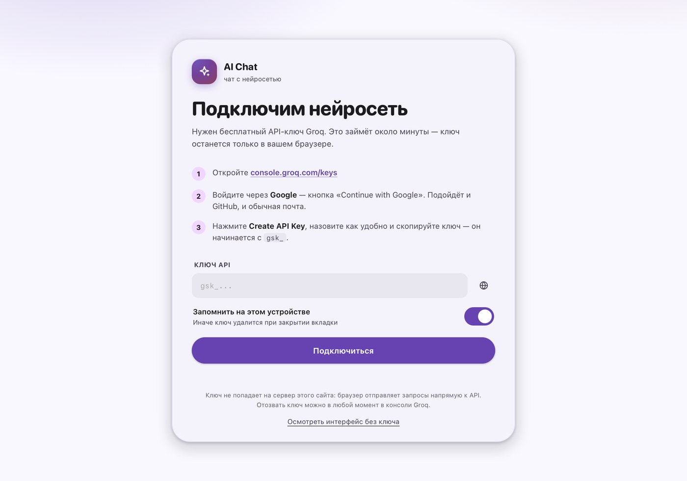

# AI Chat

**Живая версия:** https://parovozvless.github.io/ai-chat/

Простой чат с нейросетью в стиле Material You. Полностью статический сайт: без серверов, аккаунтов и базы данных. Работает на GitHub Pages.



## Как начать

1. Откройте [console.groq.com/keys](https://console.groq.com/keys).
2. Войдите через **Google** (кнопка «Continue with Google»). Подойдёт GitHub или обычная почта.
3. Нажмите **Create API Key**, назовите как угодно и скопируйте ключ — он начинается с `gsk_`.
4. Вставьте ключ на стартовом экране приложения и нажмите «Подключиться».

Ключ хранится только в браузере (localStorage или sessionStorage, если снять галочку «Запомнить»). Сайт не видит его: запросы идут напрямую в API. В любой момент ключ можно удалить в настройках или отозвать в консоли Groq.

## Что умеет

- Потоковые ответы и размышления reasoning-моделей.
- Markdown, таблицы, подсветка кода, копирование.
- Картинки для моделей со зрением (вставка, drag & drop, выбор файла).
- Выбор моделей, избранное, своя модель для каждого чата.
- Настройки генерации, системный промпт, тёмная/светлая тема, свой акцентный цвет.
- История в браузере, поиск, экспорт/импорт, командная палитра `⌘K`.
- Устанавливается как PWA (Safari: «Поделиться → Добавить в Dock», Chrome: «Установить приложение»).

## Приватность

- Нет аналитики, трекеров и сторонних скриптов.
- Нет серверной части: GitHub Pages отдаёт только файлы.
- Ключ и переписка не покидают браузер (кроме запросов к API).
- Service worker кэширует оболочку для быстрой загрузки; обновления подтягиваются автоматически.

## Локальный запуск

```bash
python3 -m http.server 8765
# http://127.0.0.1:8765
```

Для service worker нужен `http://` (не `file://`).

## Деплой

Сайт — статика в корне репозитория. Достаточно включить GitHub Pages: **Settings → Pages → Deploy from a branch → `main` / `/ (root)`**. Файл `.nojekyll` уже добавлен.

Если форкаете себе: ключи в репозитории не нужны и не должны там появляться — каждый посетитель вводит свой.
